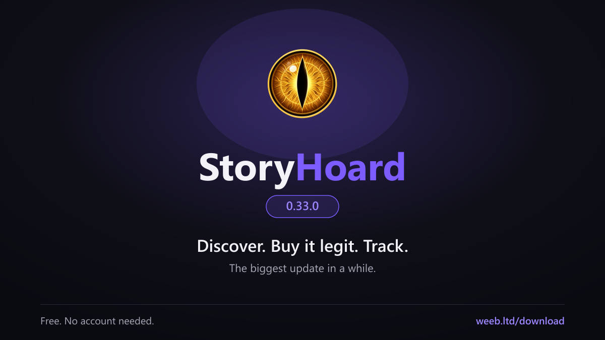
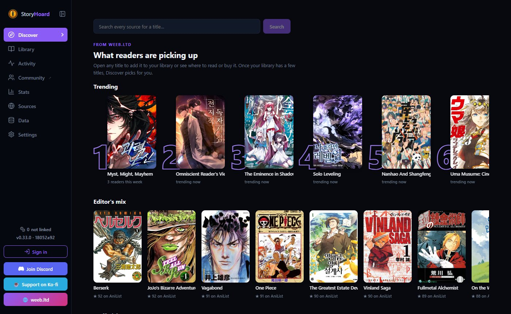
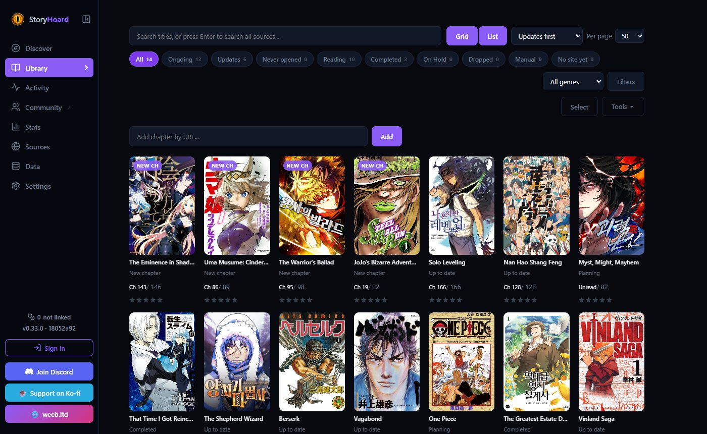
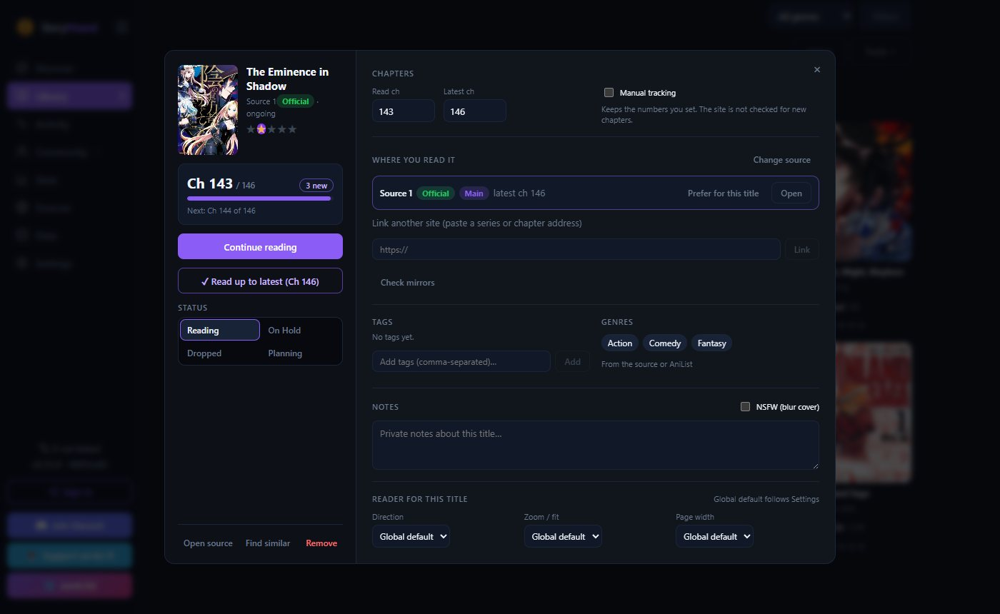
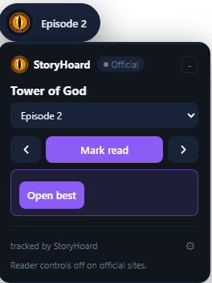

<p align="center">
  
</p>

# StoryHoard

A Firefox and Chromium extension that keeps one library for everything you read. It finds
your next title, shows where to read it or buy it, and remembers your place. Your library
lives locally in your browser.

**Website: [weeb.ltd](https://weeb.ltd)**. Install StoryHoard, find what to read next and join the community.

We collect anonymous usage stats. Turn them on or off in Settings. Every network request
the extension makes is listed in the privacy policy in Settings and at
[weeb.ltd/legal/privacy](https://weeb.ltd/legal/privacy).

<p align="center">
  
</p>

<p align="center">
  
  
</p>

## Features

**Discover**

- **weeb.ltd rails** (trending, editor's mix, staff picks, this season and community picks) lead Discover for a new library, or for any library that has no picks of its own yet. Titles you already have never show up.
- **Picks for you** from what you read: "because you read" and genre rails, with Mix it up to break up runs of one genre.
- **Title search** answers from the weeb.ltd catalog (AniList when it cannot). A title's page shows where to read it and where to buy it, official options first.
- **Add any catalog title** as Plan to read, even with no AniList entry and before you have a place to read it.
- **Search the web** on a title's page hands its name to your browser's own search engine (asks for the search permission on first use).

**Library & tracking**

- **Grid and list views** with paging (10 to 100 per page, or all), filters by status (updates, never opened, reading, completed, on hold, dropped, manual) and genre.
- **Title options in one two-pane dialog**: progress, status, chapters, where you read it, tags, genres, notes and per-title reader settings.
- **Mark read up to the latest chapter** in one click, from the dialog or the grid.
- **Reading statuses** (reading, on hold, dropped, planning, completed) with optional auto-pause after a set number of inactive days.
- **Update schedule**: titles you are reading are checked from every 5 minutes to once a day.
- **Needs attention** on Activity groups update problems by what fixes them, with one button per group.
- Star ratings, tags, categories, bulk actions, duplicate merge, a grouped reading history, reading-time stats and an activity heatmap.
- **Command palette (Ctrl/Cmd-K)** to jump to any page or title.
- **Collapsible sidebar**. The choice is remembered, and a narrow window starts collapsed.

**Reading on the site**

- Reading happens on the site itself. StoryHoard has no built-in reader.
- **The on-page panel** tracks the chapter you are on, with a chapter list, previous and next, Mark read and Mark & next. Mark & next waits until the chapter is saved, and says so if it was not.
- On official sites the panel only overlays the page and never changes it.

<p align="center">
  
</p>

**Sources**

- StoryHoard ships with the official sources built in.
- Sources show as Source 1, Source 2 or a name you type, in the order you choose.
- Access is granted one site at a time, and only when you ask for it.

**Backup & sync**

- An automatic backup before every update, restorable from Data.
- Human-readable JSON import and export, and imports from Mihon and Tachiyomi backups.
- Optional GitHub Gist backup (token stored locally, private gists).
- Optional weeb.ltd account sync across browsers.
- **AniList**: import your list, push read progress (never lowers your AniList count) and sync statuses both ways.

**Privacy & community**

- **Usage stats** are on by default and come with one line: "We collect anonymous usage stats. Turn them on or off in Settings." Nothing is sent before you have seen that line. No install id, no account link, times rounded to the day.
- **Community features** (achievements, ratings, recommendations, trending, a weekly leaderboard) stay off until you choose **Turn on** in the community card. **No thanks** sends nothing and the card does not ask again.
- Requests to weeb.ltd, GitHub, AniList and the community server are sent without cookies.

## Repository layout

- `apps/extension/` - the WXT + Svelte 5 extension (MV3)
- `apps/community-server/` - opt-in community stats API (Hono + SQLite, self-hosted)
- `apps/metadata-server/` - optional metadata catalog service (not currently deployed)
- `packages/` - shared contracts, the source SDK, and the official source adapters
- `tooling/` - browser tests
- `docs/` - architecture and development docs (see [docs/README.md](docs/README.md))

## Installing (end users)

The easiest way is the [download page on weeb.ltd](https://weeb.ltd/download), which points you to the right store for your browser. You can also download the latest release from the [Releases page](https://github.com/Ryuu3rs/storyhoard-extension/releases).

### Firefox

1. Download `storyhoard-X.X.X-firefox.xpi`
2. Open Firefox and go to `about:addons`
3. Click the gear icon → **Install Add-on From File…**
4. Select the `.xpi` file - Firefox will prompt you to confirm

> Releases are submitted to Mozilla (AMO) for signing automatically. Install the signed `.xpi` attached to the GitHub release, or install from the AMO listing.

### Firefox for Android

Firefox for Android is not an official target. The extension may install and partly work
there, but it is built and tested for desktop browsers only. The StoryHoard mobile app is
the supported phone client. See [docs/ANDROID.md](docs/ANDROID.md).

### Chrome / Chromium / Edge / Brave

Chrome no longer allows installing packed extensions from outside the Web Store (Google removed that in 2018). Until the extension is published on the Chrome Web Store, manual install requires developer mode:

1. Download `storyhoard-X.X.X-chrome.zip` and **unzip it** to a permanent folder (don't delete it - Chrome loads it live from that folder)
2. Open `chrome://extensions` (or `edge://extensions` / `brave://extensions`)
3. Enable **Developer mode** (toggle, top-right)
4. Click **Load unpacked** and select the unzipped folder

> The extension stays loaded as long as the folder exists. If you move or delete the folder it will stop working - just re-load it from the new location.

---

## Requirements (developers)

- Node.js 22 or newer
- npm 11 or newer

## Install (developers)

```powershell
npm install
```

## Development

```powershell
npm run dev          # Chromium
npm run dev:firefox  # Firefox
```

WXT launches a development browser with the extension loaded and hot-reload.

## Build

```powershell
npm run build
npm run build:firefox
```

Build output is generated under `apps/extension/.output/`.

## Validate

```powershell
npm run check        # format check, lint, typecheck, build (both browsers), tests
```

## Loading a build manually

- **Firefox:** `about:debugging#/runtime/this-firefox` → Load Temporary Add-on →
  pick any file in `apps/extension/.output/firefox-mv3/`.
- **Chromium:** `chrome://extensions` → enable Developer mode → Load unpacked →
  `apps/extension/.output/chrome-mv3/`.

## Contributing

1. Fork → branch from `main` → open a PR
2. Run `npm run check` (format check + lint + typecheck + both builds + tests) before submitting
3. Commits follow [Conventional Commits](https://www.conventionalcommits.org/) (`feat:`, `fix:`, `chore:`, etc.) - releases are automated from commit messages

## Releases

Releases are automated with release-please (see [CONTRIBUTING.md](CONTRIBUTING.md)). Each GitHub release carries the Chrome and Firefox zips plus SHA256SUMS.txt; the AMO-signed Firefox .xpi is attached automatically once Mozilla approves the submission. Firefox copies update through AMO, and a Chrome Web Store copy through the store. Only a Chromium copy loaded unpacked checks GitHub for newer versions; it offers a "Download update" button that asks for the downloads permission in that click and saves the matching zip to your Downloads folder. It never installs or runs update code.

## Documentation

See [docs/README.md](docs/README.md) for architecture and development guides.

## License

Licensed under the **Apache License, Version 2.0** (see [LICENSE](LICENSE) and [NOTICE](NOTICE)).

StoryHoard is an original codebase. It shares the "All Mangas Reader" name with an earlier,
unmaintained extension of that name but contains none of its code. You may use, modify and
redistribute it under the Apache-2.0 terms; the StoryHoard name and logo are not part of that
grant.
